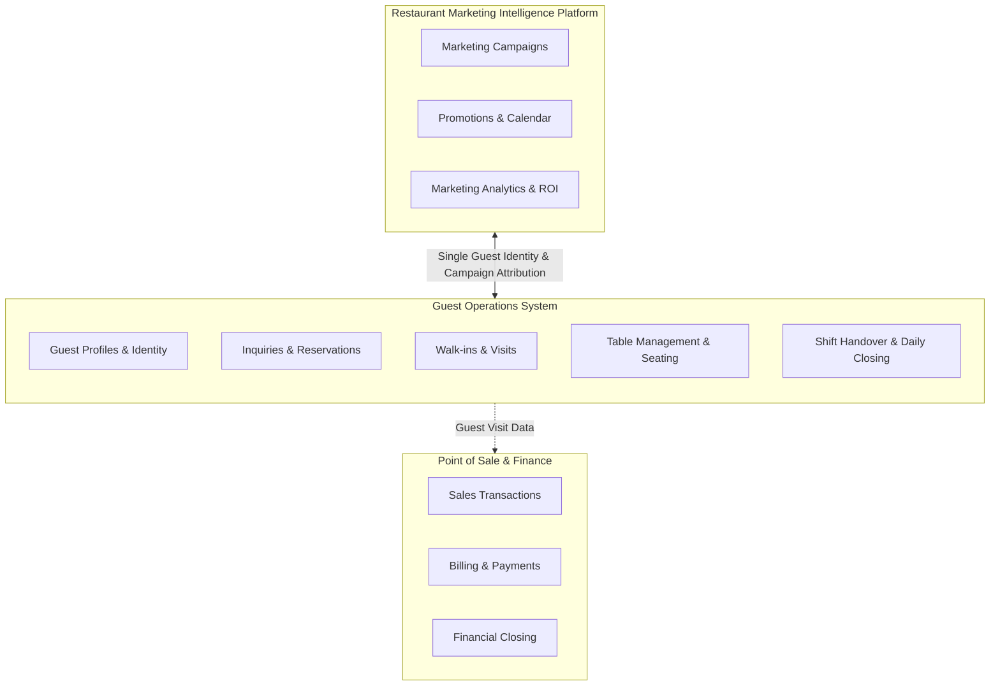
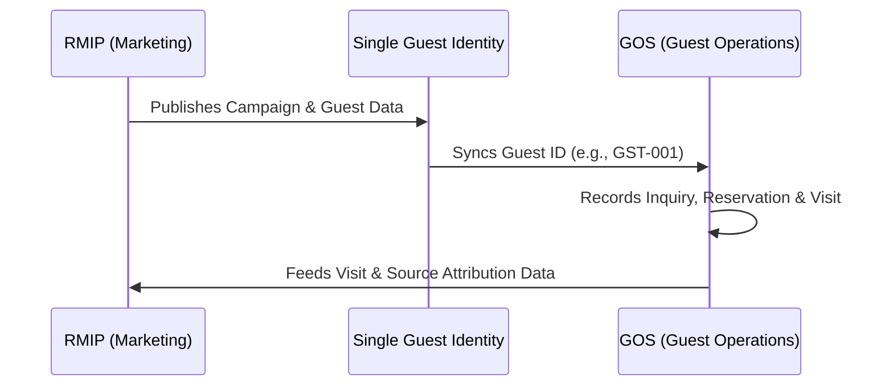

# GOS (Guest Operations System) Blueprint V1.1 Summary Report

> [!NOTE]
> **Document Status**: Working Product Blueprint v1.1 (Updated: 2 November 2026)
> **Category**: Restaurant Guest Operations & Management System
> **Primary Users**: Guest Relation Officer (GRO), Reservation Staff, Host / Guest Service, Supervisor, Manager, Admin
> **Platform Direction**: Mobile-first application

---

## 1. Executive Product Overview

**GOS (Guest Operations System)** is an operational restaurant system designed to empower Guest Relation Officers (GROs) and guest service teams in managing the complete customer journey. It spans inquiry, reservation, arrival, seating, visit management, table operations, shift handovers, and daily closing.

Crucially, GOS functions as the foundational **Guest Operational Database** and audit trail for restaurant customer activities, seamlessly bridging front-of-house operations with marketing intelligence.

---

## 2. Restaurant Technology Ecosystem Positioning

GOS operates as a specialized pillar within the restaurant tech stack, working alongside RMIP and POS systems:

| System | Core Responsibility |
| :--- | :--- |
| **GOS** (Guest Operations System) | Guest lifecycle, inquiries, reservations, arrivals, walk-ins, visits, table assignments, shift handovers, daily operational closing. |
| **RMIP** (Restaurant Marketing Intelligence Platform) | Marketing campaigns, calendar, promotions, guest segmentation, marketing analytics. |
| **POS / Finance** | Sales transactions, billing, payments, financial revenue closing. |

---

## 3. User Roles & Access Control

GOS enforces strict individual accountability. Shared accounts are strictly prohibited.

1. **GRO (Guest Relation Officer)**: Primary daily user managing inquiries, reservations, WhatsApp/phone follow-ups, guest information, walk-ins, table assignments, shift handovers, and daily closing.
2. **Reservation Staff**: Focuses on inquiry handling, reservation confirmations, and customer communication.
3. **Host / Guest Service**: Manages customer arrivals, seating, table assignments, and guest experience.
4. **Supervisor**: Oversees daily operations, GRO tasks, shift handovers, and daily closing.
5. **Manager**: Full operational supervision and outlet management permissions.
6. **Admin**: System configuration, user management, organization/outlet setup, and permission governance.

---

## 4. Application Navigation (5 Core Tabs)

GOS is built with a mobile-first, fast-action layout structured around 5 primary tabs:

- **TAB 1 — TODAY**: The GRO operational command center answering *"What do I need to do today?"*. Includes Daily Overview (expected guests, confirmed/pending reservations, walk-in count, follow-ups pending, special requests, upcoming events), My Tasks, Shift Briefing, and Quick Actions.
- **TAB 2 — RESERVATIONS**: Inquiry logging, full reservation CRUD lifecycle, status tracking (Confirmed, Pending, Cancelled, No-Show), WhatsApp/phone interaction logging, and follow-up reminders.
- **TAB 3 — GUESTS**: Single Guest Identity directory, guest profile search, visit history, classification (VIP, Regular, etc.), and duplicate identity matching.
- **TAB 4 — CLOSING**: Daily operational rekap by business date and outlet (total reservations, arrivals, completed visits, cancellations, no-shows, walk-ins, guest counts, new vs. returning guests, source/campaign attribution).
- **TAB 5 — MORE**: Outlet selection, user profile, shift management, handover submission, and system settings.

---

## 5. Key Operational Workflows & Guest Touchpoints

### A. Inquiry & Reservation Lifecycle
- Inquiries captured via WhatsApp, phone, or walk-in.
- Converted into Reservations with metadata (guest count, date/time, source, campaign reference, special requests).
- Status tracking: `Pending` → `Confirmed` → `Arrived` / `No-Show` / `Cancelled`.

### B. Walk-in & Visit Management
- **Walk-in**: Inputted via Today Quick Action or directly from Table Management. Captures guest name, contact, actual guest count, arrival time, source, and assigned table.
- **Visit**: Created upon arrival of a confirmed reservation or walk-in. Tracks actual arrival time, actual guest count, table ID, assigned GRO, and visit status.

### C. Shift & Handover System (`LOCKED — Core Direction`)
- Ensures operational continuity across shifts without loss of context.
- **Shift Start**: User logs in → System identifies shift → Displays Shift Briefing & previous shift's handover notes.
- **Handover Submission**: Outgoing GRO submits open tasks, pending follow-ups, VIP notes, and unfinished reservations before shift end.

### D. Table Management & Table Intelligence
- Visual layout builder corresponding to physical outlet areas (Indoor, Outdoor, VIP, Smoking, Non-Smoking, Private Room, Window Area).
- Real-time table states: `Available`, `Occupied`, `Reserved`, `Cleaning`.
- Quick table assignment linking guests directly to seating.

---

## 6. Data Architecture & Core Objects

GOS defines **20 Core Data Objects** with rigorous relational integrity:

1. **Organization**
2. **Outlet** (belongs to Organization)
3. **User** (belongs to Outlet/Organization)
4. **Role** (defines User permissions)
5. **Shift** (tracks operational shifts per outlet)
6. **Handover** (links shifts for operational continuity)
7. **Task** (actionable items assigned to Users)
8. **Guest** (Single Guest Identity record)
9. **Inquiry** (pre-reservation customer query)
10. **Reservation** (booked table request)
11. **Visit** (actual customer arrival & seating record)
12. **Walk-in** (unreserved arrival)
13. **Table** (physical seating unit)
14. **Table Area** (zoning: Indoor, Outdoor, VIP, etc.)
15. **Table Assignment** (links Visit/Reservation to Table)
16. **Campaign Reference** (tracks marketing origin from RMIP)
17. **Calendar Event Reference** (special events / holidays)
18. **Daily Closing** (end-of-day operational summary)
19. **Activity Log** (audit trail for individual accountability)
20. **Notification** (system alerts and reminders)

---

## 7. GOS ↔ RMIP Integration Guidelines

- **Integration Philosophy**: GOS acts as the **Guest Operational Database**, while RMIP serves as the **Customer Relationship & Marketing Intelligence** layer.
- **Single Guest Identity**: Both systems share the exact same `Guest ID` (e.g., `GST-001 — Budi Santoso`). Marketing teams do not maintain a siloed database separate from operational guest profiles.
- **Data Provenance**: Campaign and source references flow seamlessly from RMIP into GOS reservations, enabling accurate attribution of marketing campaigns to actual in-store visits and revenue.

---

## 8. MVP Scope vs. Deferred Features

### MVP Scope (Phase 1 & Phase 2)
- **Auth & Identity**: Login, role-based access, outlet assignment, activity logging.
- **Today Module**: Daily overview, tasks, follow-ups, shift briefing, handover notes, quick actions.
- **Reservations**: Inquiry logging, reservation CRUD, status management, phone/WhatsApp logging.
- **Guests**: Guest profiles, search, history, classification, identity matching.
- **Walk-in & Visit**: Walk-in input, arrival tracking, actual guest counts, visit creation/completion.
- **Shift & Handover**: Shift start, briefing, open task transfer, handover submission.
- **Table Management**: Configuration, layout, status workflow (`Available`, `Occupied`, `Cleaning`, `Reserved`).
- **Daily Closing**: Operational summary, guest counts, reservation results, source breakdown.
- **RMIP Integration**: Campaign ID reference, Guest ID synchronization, data source tracking.

### Deferred Features (Post-MVP)
- Direct WhatsApp Business API integration (manual logging used initially).
- Automatic phone call recording.
- POS integration & payment processing.
- Financial closing.
- Advanced table optimization & AI Guest Intelligence.
- Loyalty and membership points programs.

---

## 9. Locked Product Principles

1. **Guest Journey First**: Capture every customer touchpoint from inquiry to visit.
2. **Operational Continuity**: Zero loss of context across shift changes.
3. **Individual Accountability**: Every action tied to a distinct user ID and timestamp.
4. **Data at Point of Interaction**: Record data immediately when interaction occurs.
5. **Fast Operational Workflow**: Optimized for high-speed use during peak restaurant hours.
6. **Single Guest Identity**: Unified Guest ID shared between GOS and RMIP.
7. **Clear Data Ownership**: GOS (operations), RMIP (marketing), POS (transactions/revenue).
8. **Independent Core Operation**: GOS operates fully even without RMIP or POS connection.
9. **Operational Visibility**: Clear real-time view of reservations, guests, tables, and tasks.
10. **Evidence-Based Intelligence**: Insights derived from actual, validated operational data.

---

## 10. Implementation & Pilot Plan

- **Phase 1 (Operational Foundation)**: Auth, User Identity, Today, Reservation, Inquiry, Guest Profile, Walk-in, Visit, Basic Daily Closing.
- **Phase 2 (Shift & Operational Continuity)**: Shift management, shift briefing, task ownership, handover, activity history, follow-up workflows.
- **Validation & Pilot**: Recommended pilot on 1 restaurant / 1 outlet over a 4-week structured rollout. Target KPIs: ≥80% reservations recorded in GOS, ≥80% source tracking, ≥70% guest ID linking, ≥80% daily closing submission rate.
